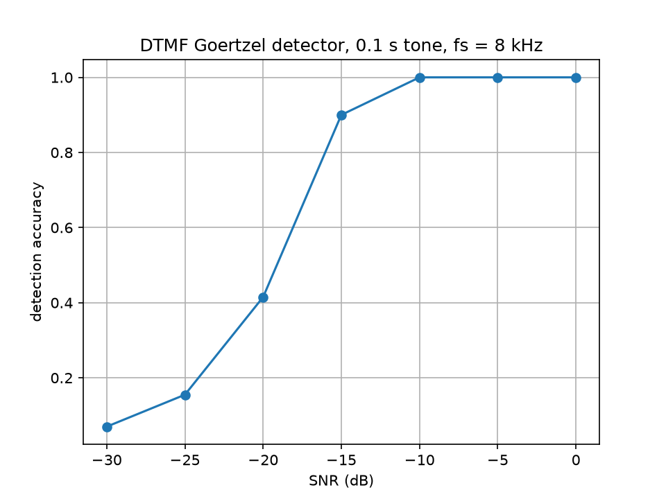

# DTMF tone detector: Python → C → STM32

Decodes which of the 16 DTMF keys was sent from its tone pair, in noise. The same detector is built three times: in Python as reference, in C (float and Q15 fixed-point), and on an STM32F407. The aim is to measure what each constraint costs in accuracy and cycles, and how much of that cost design choices recover.

## Results
- **Accuracy:** the Goertzel detector decodes all keys down to -10 dB SNR. Q15 matches float within trial noise once the input is scaled properly.
- **Fixed-point design:** the noisy input must be scaled to fit the Q15 format's range. A large scale clips noise peaks at low SNR; a small scale loses resolution. The sweep found 1/32 to be best.
- **Cost:** about 108 cycles per input sample at -O2 (all 8 tones), which is 0.5% of the CPU at 8 kHz. At 168 MHz the detector alone would use the whole CPU at about 1.5 MHz sampling rate (ignoring ADC and DMA overhead).
- **Takeaway:** on a Cortex-M4F with an FPU, Q15 gives no speed benefit; its value is on cores without an FPU and for bit-exact results.


## Steps and goals
1. **Python reference** (no hardware limits): tone generator, noise, detector, accuracy vs SNR. This is the best result the later steps are compared against.
2. **C on PC** (gcc): float first, then Q15 fixed-point. Goal: error vs Python, and fixing fixed-point problems (overflow, coefficient rounding, block length).
3. **STM32F407**: the same detector (float and Q15) running on the board on a stored test signal. Goal: correct key and cycles per block (DWT counter) against the real-time budget.

## Method
Each DTMF key signal is represented by the sum of two sine waves: one tone each from **Low** and **High** group.
- Low group (697, 770, 852, 941 Hz)
- High group (1209, 1336, 1477, 1633 Hz)
These 8 frequencies give 16 unique pairs of DTMF keys that represent the 16 keys (i.e. 0-9, A-D, #, *).

Noisy signal references were simulated in Python with random seed for reproducibility.

Test Setup:
- SNR range: -30 to 0 dB in 5 dB steps (below 0 dB the noise is louder than the tone)
- Sampling rate = 8 kHz
- Sampling window = 100ms
- Test samples = 200 random keys per SNR point (with random seed defined random.seed(0))
- Noise: Gaussian (random), scaled so signal power / noise power matches the target SNR

The detector measures the signal energy at each of the 8 frequencies and picks the strongest in each group to determine which key was sent.

Energy is computed with the Goertzel algorithm, the standard choice for DTMF: it needs only multiply and add and two state variables per frequency, which reduces the computational demands of the direct approach and makes it better suited to a hardware-efficient implementation (fixed-point integer code on a microcontroller).

## Additional Results
### Step 1 - Python Reference 

Step 1 is the baseline: the signal is processed in floating-point Python with no hardware restrictions, but with noise added. It shows how well the method detects keys at best, so steps 2 and 3 can be compared against it.



Accuracy drops as noise increases: 100% at -10 dB and above, 88% at -15 dB, 39.5% at -20 dB, 21% at -25 dB, and 11.5% at -30 dB, about twice chance (6.25%).

| SNR (dB) | Python (hits of 200) |
|---|---|
| 0 | 200 |
| -5 | 200 |
| -10 | 200 |
| -15 | 176 |
| -20 | 79 |
| -25 | 42 |
| -30 | 23 |

The Goertzel detector (step 1b) gives the same table on the same noisy signals. Its energies match the direct method (step 1a) to rounding error (relative difference ~1e-12), so this table is the baseline reference for steps 2 and 3.

## How to reproduce
Run from the repo root:
```bash
python python/export_signals.py
python python/read_signals.py
gcc -Wall -Wextra -o c/read_signals c/read_signals.c -lm
gcc -Wall -Wextra -o c/goertzel_q15 c/goertzel_q15.c -lm
./c/read_signals
./c/goertzel_q15
```
`export_signals.py` writes the test signals to `c/signals.txt`. `read_signals.py` and the two C programs print hits per SNR in the same format, so the outputs can be compared directly; `read_signals.py` also saves `accuracy_vs_snr.png`.

To try another Q15 input scale, override it at compile time (in PowerShell):
```bash
gcc "-DINPUT_SCALE=0.125f" -o c/goertzel_q15 c/goertzel_q15.c -lm
```

### Step 2 - Fixed-Point implementation
Test data: 7 SNRs x 200 trials = 1400 signals, written to `c/signals.txt` (not in git; generate it with `python python/export_signals.py`, see How to reproduce).

Hits out of 200 trials per SNR for the Goertzel detector, Q15 at several input scales against float (all on the same 1400 signals; Python and C float give identical detection). The Q15 input must fit [-1, 1), so the signal is scaled before conversion.

With the first scale, 1/4, Q15 lost accuracy at low SNR, largest at -20 dB (19 hits fewer than float). The cause was clipping of large noise peaks at the input. Smaller scales clip less, and 1/32 (a power of two, so a shift on the MCU) matches float within trial noise (about 6 hits at 200 trials, so the -25 and -30 dB differences mean nothing). 1/32 is the default.

| Q15 scale | 0 dB | -5 dB | -10 dB | -15 dB | -20 dB | -25 dB | -30 dB |
|---|---|---|---|---|---|---|---|
| 1/2 | 200 | 200 | 199 | 143 | 59 | 36 | 19 |
| 1/4 | 200 | 200 | 199 | 161 | 60 | 30 | 20 |
| 1/8 | 200 | 200 | 200 | 170 | 70 | 28 | 21 |
| 1/16 | 200 | 200 | 200 | 175 | 86 | 33 | 22 |
| 1/32 | 200 | 200 | 200 | 176 | 79 | 46 | 22 |
| float | 200 | 200 | 200 | 176 | 79 | 42 | 23 |

### Step 3 - STM32 board implementation
Setup: STM32F407 at 168 MHz, 800 samples (100 ms block), float and Q15 detectors, cycles with the DWT counter, a stored test signal (key 5 at 10 dB), result via SWV.

| Build | Float cycles | Q15 cycles | Float cycles/sample/tone | Q15 cycles/sample/tone | Float % of budget | Q15 % of budget |
|---|---|---|---|---|---|---|
| -O0 | 292228 | 595721 | 45.7 | 93.1 | 1.74% | 3.55% |
| -O2 | 86711 | 87839 | 13.5 | 13.7 | 0.52% | 0.52% |

- Cycles per sample are per tone (8 tones run per block), so about 108 per input sample at -O2. The budget is 16.8M cycles per 100 ms block.
- Both detectors decode key 5 on the stored test signal.
- At -O0 Q15 is about 2x float. At -O2 they are within about 1.3%, and -O2 is 3.4x faster for float and 6.8x for Q15.
- The likely reason the gap closes is that the Goertzel recurrence is latency-bound (hypothesis, not measured).
- Limits: one stored signal, no live ADC/DAC loopback, accuracy vs SNR measured on the PC only.

To reproduce the board result: import `board/blink` into STM32CubeIDE and build the Debug configuration (-O0, or set -O2 in the project properties). Flash with Debug, open the SWV console (ITM port 0, core clock 168 MHz) and resume. The program prints the decoded key and DWT cycles for the float and Q15 detectors. The test signals are the committed headers `test_signal.h` and `test_signal_q15.h`; `python/export_header.py` regenerates them with new noise, so rerunning it changes the signal.

