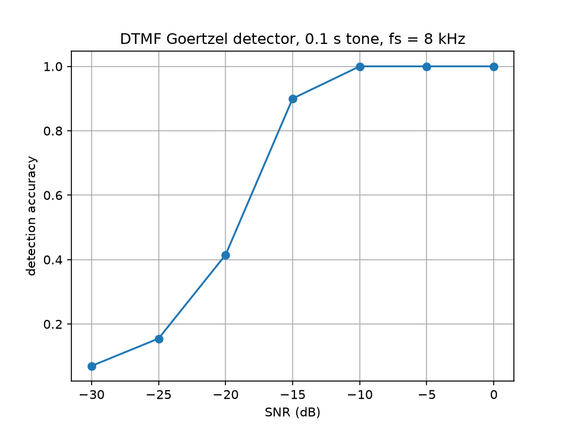

# DTMF tone detector: Python → C → STM32

Detects keypad keys from DTMF tone pairs in noise. Built three times with the same method: a Python reference, C on PC (float, Q15), and C on an STM32F407, with accuracy, error vs Python and cycles per block measured.

## Status
- [x] Step 1: Python reference
- [ ] Step 2: C on PC (float, Q15)
- [ ] Step 3: STM32F407

## Method
Each DTMF key signal is represented by the sum of two sine waves: one tone each from **Low** and **High** group.
- Low group (697, 770, 852, 941 Hz)
- High group (1209, 1336, 1477, 1633 Hz)
These 8 frequencies give 16 unique pairs of DTMF keys that represent the 16 keys (ie. 0-9, A-D, #, *).

Noisy signal references were simulated in Python with random seed for reproducibility.

Test Setup:
- SNR < 0 dB: noise is louder than the tone
- Sampling rate = 8 kHz
- Sampling window = 100ms
- Test samples = 200 random keys per SNR point (with random seed defined random.seed(0))
- Noise: Gaussian (random), scaled so signal power / noise power matches the target SNR

The algorithm will pick the strongest frequency from each group to determine which key was pressed. This will be the accuracy reference for final evaluation.

## Results
### Step 1 - Python Reference 


As shown in figure, accuracy drops as noise level increases. The result was accurate when the noise is lower (>-15 dB), 100% at -10 dB and above. The performance dropped significantly as higher noise was introduced, 41.5% at -20 dB, near chance (6.25%) at -30 dB.

| SNR (dB) | accuracy |
|---|---|
| -30 | 0.07 |
| -25 | 0.155 |
| -20 | 0.415 |
| -15 | 0.9 |
| -10 | 1.0 |
| -5 | 1.0 |
| 0 | 1.0 |

## How to reproduce
```bash
python plot_accuracy.py
```
Prints the table values and saves `accuracy_vs_snr.png`.